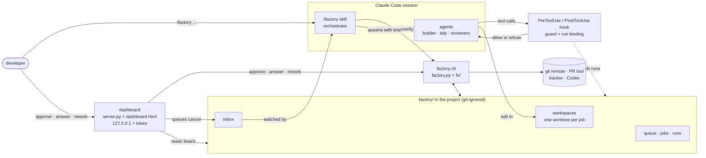
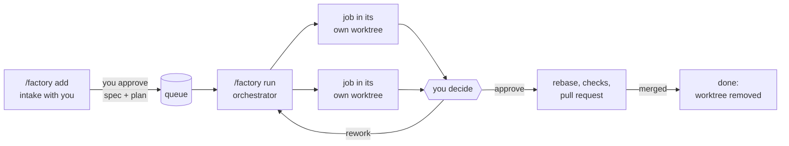
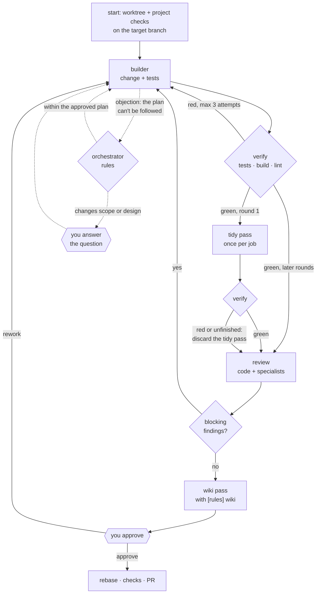
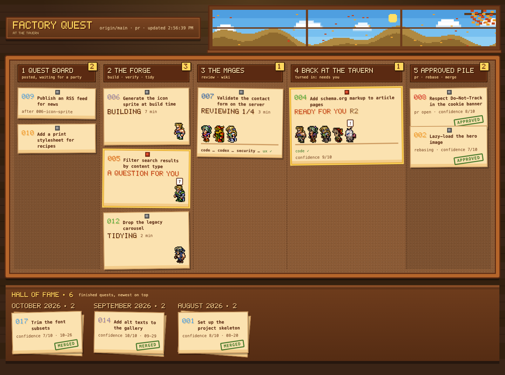
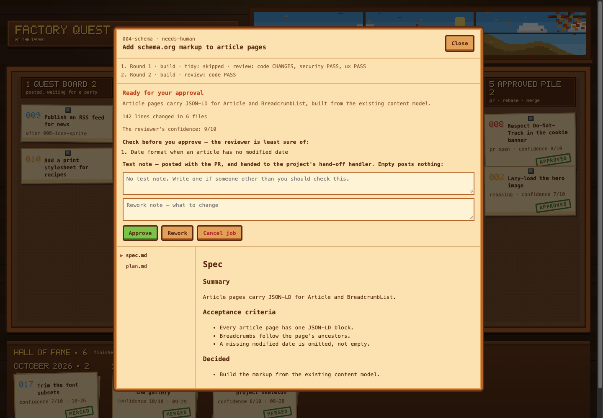

# Software factory

A Claude Code plugin that turns an approved case into a pull request. You frame a case once, together
with Claude, into a spec and a plan you approve. The factory then builds it with fresh agents — a
builder that writes the change and its tests, a tidy pass, a main reviewer and specialists where the
change calls for them — runs the project's own tests, build and lint, and hands the job back to you
for approval before anything reaches a PR. It stops and asks whenever a decision is yours.

A personal tool for use across work projects: in a project it changes no committed file. Python
standard library only. It was first built from a blueprint prompt; this repo is now the source.

## Commands

| Command | What it does |
|---|---|
| `/factory init` | Once per project: writes `factory/project.md` — commands, what verify runs, test conventions, worktree setup, how many jobs at once, reviewers and their path patterns, hand-off. |
| `/factory add <CASE-KEY or text>` | Intake: frames one case with you into `spec.md` and `plan.md`, and queues it once you approve. Any number of intake sessions can run, also while the factory builds. |
| `/factory run` | The orchestrator: builds queued jobs until every job is finished, and starts the dashboard. |
| `/factory approve <id>` | Approves a job that has passed review; it then goes on to rebase, checks and PR. |
| `/factory answer <id> <text>` | Answers a question the factory stopped on; the builder continues. |
| `/factory rework <id> <note>` | Sends a job back for another round with your note. |
| `/factory cancel <id> [reason]` | Stops a job, closes its PR, removes its branch and worktree. |
| `/factory stop` · `/factory status` | Take no new job · show the board in the terminal. |
| `factory-dashboard` | The dashboard without a run, to read the queue and jobs. |

Approve, answer, rework and cancel work from any session and from the dashboard. The first three take
effect at once; a cancel waits in `factory/inbox/` until the orchestrator runs it.

## Architecture

The orchestrator is the Claude Code session itself, following `SKILL.md`. It decides nothing
mechanical: every step is `factory-cli` (`factory.py` and `fx/`), which reads and writes the project's
`factory/` folder, prints JSON and says what to do next. Agents are fresh sub-agents spawned from a
brief the CLI wrote; a plugin hook confines each one to its own run.



- **State lives on disk**, in `factory/`; nothing is held in the session, so a restart resumes where the
  folders say it stopped.
- **One orchestrator** holds a lease and does all the building. The developer's approve, answer and
  rework only write the job folder, so they apply at once from anywhere; a cancel waits for the
  orchestrator, which alone can stop the job's agents.
- **Agents never compose their own prompt or choose their own files**: `F brief` writes the prompt from
  state, and the hook allows a write only inside that run's job and role.

## How it works

### From case to pull request



The orchestrator builds up to `[factory] parallel` jobs at once, each on its own branch in its own
worktree. A job queued `--after` another waits until that one is done. Integration is one job at a
time.

### One job



1. **Builder** — the change, with tests where behaviour changes (logic and helpers above all), TDD
   where it helps, and for a bug a test that reproduces it: tests.md records how it failed before the
   fix. tests.md maps each acceptance criterion to its test. No commit order is imposed.
2. **verify** — the project's tests, build and lint (`[factory] verify`, default lint, build, suite);
   red sends the builder back within the round. A result counts only for the same head and commands.
   The builder runs targeted checks while it works; this is the one full run. A rebase that leaves
   HEAD unchanged reuses a green result; one that moves the code is checked again.
3. **Tidy** — once per job, after round 1's first green verify: a fresh agent makes the change smaller
   and simpler without changing behaviour — needless comments, tests that add nothing (never one
   tests.md maps to a criterion or a reproduction), dead code, needless complexity in the files the
   change touches, and whatever the change left without a user, wherever it lives. Then verify again;
   red, unfinished or uncommitted resets the branch to the builder's result. round-1/tidy.md lists each
   removal for the reviewer and the PR.
4. **Review** by Mages, each by the rulebook `[mages]` gives it — a skill of the project's or one of the
   factory's defaults: the main Mage (`code`) always; another when plan.md's `Specialists:` line names
   it or its `[paths]` pattern matches.
   The factory reads each verdict from the findings — CHANGES only for a BLOCKING one — and merges all
   findings into one `findings.md`, same `path:line` = one item.
5. **Fix rounds** rerun only the reviewers that blocked, on the diff since their last look.
6. **Wiki** — with `[rules] wiki`, once the round's reviews all passed: a fresh agent makes the
   project's existing wiki pages true to the change and commits them, so you approve them with it.
7. **Needs-human, ready** — every job stops for the developer's approval, with the diff size against
   `max_diff` and the main review's least-sure list. Then rebase, the project's checks, PR.

spec.md's `## Decided` is settled for every agent; project.md's `[rules] docs` (a wiki's
architecture and component pages) are rules every brief lists.

### When it waits for you

| What you see | What you decide | How you answer |
|---|---|---|
| **Ready for your approval** — summary, diff size, what the reviewer is least sure of and its confidence (1–10), what to check by hand | Is this what you want in the PR? | Approve, or Rework with a note |
| **Your decision** — a question with options, one recommended | Which way, when the plan can't be followed as approved | Pick an option or write your own; it goes into spec.md's `## Decided` |
| **Stopped** — the reason (red target, too many attempts, blocking findings after the last round) | What to do next | Rework with a note, or Cancel |

### The dashboard



Opening a job shows what happened round by round, what you decide, and only the buttons that fit:



*Screenshots show invented demo jobs, not a real project.*

`/factory run` starts it and gives its URL (127.0.0.1, with a token); one runs per project, and a
second start links to it. Each job is a card in one of three columns — needs you, in progress,
waiting for merge — with its status, the running agent's time, and the agents working on it drawn as
pixel-art figures with their state: hammering, reading, cheering a pass, stamping at a blocking
finding, or a herald holding up what waits for you. The queue and the finished jobs sit in a column
of their own. Opening a job shows a few lines of what has happened, round by round, then what to
decide and only the buttons that answer it. The header says when no orchestrator is running, since
your commands then wait for the next run.

Above the cards is a village, as a backdrop: the same figures walk to the smithy, the yard, the
chapel, the village hall and the stable as their jobs move, under a sky that follows the local
clock and the season. A wider screen shows more countryside, not a bigger village. Everything is
drawn in code in `dashboard.html`; there are no image files. The main reviewer ends its review with
`Confidence: n/10`, and the herald's face shows it: happy from 8, worried below 5.

## Several jobs at once

- **One worktree per job**, `factory/workspaces/<id>/`, on the job's branch: created at `start`
  (workspace_setup there — for pnpm its own node_modules from the shared store), kept through
  building, review, fixes and waiting for approval, removed at finish or cancel. Setup reruns only
  when a listed lockfile changes.
- **At most `[factory] parallel` active jobs** (1 or more, default 2; `/factory init` asks the
  developer). The tests fill three slots with their own worktrees and ports; real agents have run
  at most two. `F next --lease` returns them: jobs holding a
  slot keep it, a job coming back from waiting (a rework) takes the next free one, then the queue.
  A job waiting for a human keeps its worktree but holds no slot.
- **One orchestrator**: `F lease acquire` (a stale lease is taken over only with `--takeover`); `F
  next` refuses without the current lease, so a second orchestrator takes no job.
- **Explicit job identity**: `ws run <job>`, `git -C factory/workspaces/<job>`, logs under
  `factory/logs/<job>/`, verify results in the job's round folders.
- **Agent runs** (`factory/runs/`): `F brief` reserves the run and refuses while a live one holds the
  same work, so a builder attempt or a reviewer is never started twice, also after a restart. The
  plugin's PostToolUse hook on the Agent call attaches the `agentId` Claude Code returns; SubagentStop
  ends it; a reservation no agent took expires after three minutes, a running agent that goes silent
  after the suite timeout. state says `wait-agent` while a job's agent runs.
- **Binding from the brief, not the path**: the guard allows a write only through a live running run
  whose `agent_id` is the hook's, in that run's job and role. A done, aborted or expired run's agent
  writes nothing; without `agent_id` nothing is written. If an agent's id matches no run, the reason
  is recorded and `F next` stops the factory — it never falls back to weaker isolation.
- **Ports**: each job has one port, `FACTORY_PORT`, kept in its workspace.json — the same for all its
  commands, never another job's, re-picked when something outside holds it. A `[server] command` is
  started on it for the commands in `[server] for`, waited for and stopped; a test command may also
  start its own server on it. `FACTORY_OUTPUT` is the job's own folder.
- **Shared data**: the commands in `[factory] serial` (migrations, seeding, tests writing a shared
  database) share one lock; everything else runs in parallel.
- **Order between jobs** is explicit: `queue add --after <id>` waits until that job is done. Known
  overlaps in shared contracts, styles or dependencies are noted at intake; nothing tries to predict
  file conflicts.
- **Integration** is one job at a time, with the developer's approval per job and no new automatic
  merge. When the target moves, an approved job rebases and runs the checks again before its PR —
  an open PR too: `pr status` fetches the target, the branch is rebased and checked, and the same PR
  is updated. A clean rebase keeps the approval and, when nothing moved, reruns nothing; a rebase
  that needed conflict resolution goes back through the builder and review and needs approval again.

## Install

Needs Claude Code, Python 3 (standard library only) and git. Optional: `gh` or `az` for pull requests,
the Codex CLI for the `codex` review.

Once per developer: clone this repo, then add the clone as a local marketplace (use your own path):

```
git clone https://github.com/systerdyster/softwarefactory.git
/plugin marketplace add <path-to-your-clone>
/plugin install factory@software-factory          # user scope
```

Use user scope while the marketplace is a local path: project scope writes the path into the
repo's committed settings, which breaks for everyone else. Then, in each project: `/factory init`.

A plugin from a local-directory marketplace loads in place, so edits here take effect at the next
session start or `/reload-plugins`, with no version bump. To try a change without the installed
copy: `claude --plugin-dir <path-to-your-clone>/plugins/factory`.

## Layout

```
.claude-plugin/marketplace.json
plugins/factory/
  .claude-plugin/plugin.json
  bin/factory-cli, factory-dashboard      on PATH while the plugin is enabled
  hooks/hooks.json                        the PreToolUse guard for factory agents
  skills/factory/
    SKILL.md, reference/                  routes init | add | run | stop | approve | answer | rework | cancel | status
    bin/factory.py, hook.py, fx/          every mechanical step; prints JSON, exits non-zero on failure
    bin/tests/                            unittest, real temp git repos with a bare origin
    server.py, dashboard.html             dashboard + inbox, 127.0.0.1 with a token
  agents/factory-*.md                     builder, tidy, wiki, mage (every reviewer), codex-fallback
  defaults/skills/                        review-{code,security,performance,stability,platform,ux,ui}
                                          rulebooks, case-status; used in place or copied into a project
```

A personal tool: in a project the factory changes no committed file. It leaves only `factory/`
(runtime state, ignored through `.git/info/exclude`) and the allowlist that `/factory init` adds to
`.claude/settings.local.json`.

Run the tests with `python3 -m unittest discover -s plugins/factory/skills/factory/bin/tests` from
the repo root (or `-s tests` from `skills/factory/bin`).

## Decisions taken while building, beyond the blueprint

- **One plugin-level PreToolUse hook** (`hook.py`) enforces the per-role limits. Plugins ignore
  `hooks` in agent frontmatter, so the hook runs for every matching tool call in every session,
  returns at once unless `agent_type` is a `factory:` agent, and fails closed for an unknown factory
  agent name. Reviewers: read-only git, the project commands `[reviewers] commands` lists, and their
  own review file. Builder: the workspace, build.md and tests.md, never push/switch/rebase/amend/
  `--no-verify`. No agent may edit the plugin's files or spawn agents.
  Shell operators are refused, so every command matches the allowlist plainly. `workspace check`
  after review stays as the second line of defence.
- **Every reviewer is one agent, `factory-mage`, reviewing by a rulebook.** There was an agent per
  reviewer, with its rubric in the agent file, so a project's own review skill could only be read as
  a rule beside the factory's rubric. Now `[mages]` names each Mage and its rulebook: a skill of the
  project's (read from the target branch and copied into the job folder: the builder writes anywhere
  in the worktree, and the change under review must not rewrite the rules it is reviewed by) or one of the factory's
  defaults, `defaults/skills/review-<name>`, used in place. The rulebook says what to look for; the
  review contract says how to report, and gives the main Mage its acceptance criteria, least-sure list
  and confidence line whatever its rulebook. The rulebook's `model:` front matter picks the model
  (`next.models`). Since the agent no longer says which reviewer it is, the guard takes a Mage's role
  from the run its brief reserved; before the run is attached it may read, and write nothing. A
  rulebook that is missing stops the job for the developer.
- **An agent gets the skills it is given, not all of them.** Every brief used to list every skill in
  the project as a rule, so a builder read release and hotfix procedures beside the craft skills it
  needed. Now `[heroes]` names the skills the builder (`coder`), the tidy pass (`scout`) and the wiki
  pass (`writer`) follow, and `[mages]` each Mage's rulebook; the written rules (CLAUDE.md, AGENTS.md,
  `[rules] docs`) still reach everyone. A skill was written for a person working on a case, so the
  brief scopes it to the job — its diff stands in for a git range or a release — and the agent file
  and brief win over a skill's branch, push, PR, tracker and commit steps. `writer` replaces
  `[rules] wiki_guide`. A named skill that is missing stops the job for the developer.
- **Intake reads the case and checks readiness the project's way.** `[intake] read` names the
  project's skill for reading a case from its tracker (only its reading part: intake does the claim
  and the plan), and `[intake] ready` its definition of ready, which intake checks the spec and plan
  against before the developer approves: each requirement met, settled, or recorded in `## Decided`
  as their choice to go ahead without it. The factory still owns the grill and the format of
  spec.md and plan.md, which every agent reads. `F intake` resolves both from the main checkout,
  since no worktree exists yet.
- **An older project.md is refused, not half read.** `[jira]`, `[reviewers] enabled`, `[rules]
  wiki_guide` and `[handoff] jira_link`/`jira_url` stop every command with what each became, and
  `/factory init` proposes the new form for the developer to approve (init.md has the table). No code
  translates them: it is a one-off for a handful of projects, and a fallback that read the old keys
  would have to live as long as the oldest unmigrated project.
- **Agents run project commands through `factory-cli ws run <job> <name>`**, named in project.md's
  `[commands]`, so one allowlist rule (`Bash(factory-cli:*)`) covers every project's build, lint and
  test without listing free-form shell, and it does not change between plugin versions.
- **The project root comes from where the command runs** (`FACTORY_ROOT`, else `CLAUDE_PROJECT_DIR`,
  else git), since the code no longer sits inside the project.
- **Agents are spawned by their scoped name**, `factory:factory-builder` and so on.
- **`F brief` writes every agent prompt from `state`**, and refuses an agent state didn't ask for. The
  orchestrator never composes a brief.
- **A full-suite `verify` after every builder round**, before reviewers spend a round on red code. A red
  verify reruns the builder in the same round (max 3 attempts), not a new review round.
- **Stuck detection**: an agent spawned three times for the same head without progress goes to
  needs-human instead of looping.
- **Rebase conflicts stay in progress** and go to the builder; `rebase --continue` is the script's. A clean green rebase keeps
  the approval (heads are tracked as equivalent); anything an agent resolved is reviewed again.
- **`auto-merge` = PR with auto-complete** (`gh pr merge --auto` / `az repos pr update --auto-complete`),
  so branch policies still apply. **`local-merge`** builds the `--no-ff` merge with plumbing and refuses
  when the target branch is checked out anywhere (moving the ref under a checkout would touch the
  developer's checkout); the job then goes to needs-human with the command to run.
- **Approve, answer and rework apply at once; only cancel goes through the orchestrator.** They first
  all waited in `factory/inbox/` for the orchestrator to run them, so without a run the dashboard's
  approve did nothing, and the run needed a refused/done round trip for each. But they only write the
  job folder, and state is derived from it, so whoever gives one — the dashboard, any session — applies
  it and records it as applied or refused in `factory/inbox/done/`. A cancel must stop the job's
  running agents, which only the orchestrator can, so it still waits in the inbox. The orchestrator
  watches both with Monitor (`F inbox watch`): a cancel to run, or an applied command that may give a
  job something to do.
- **The factory knows no tracker; the project's event handlers do.** The factory decides when a job
  is claimed, started, waiting, handed off, completed or cancelled; `[events]` in project.md names
  what each means for the project — a shell command, or a skill the session runs with its own tools
  (Jira is reached only through them). `state` lists the handlers due (`events_todo`), and
  `factory/jobs/<id>/events.md` logs each once it ran, so a restart never repeats one. A handler
  that fails is logged as failed and tried again, three times, then reported in `events_given_up`
  instead of running on every step. The factory's own steps after approval — rebasing, merging,
  retrying a blocked merge — start nothing, so a case in review isn't moved back and forth whenever
  the target moves. It first had
  Jira built in, with a status mapping and the orchestrator doing transitions itself, which fitted
  none of the projects using Azure Boards or no tracker. The factory ships a default Jira handler,
  `defaults/skills/case-status`, for a project to copy into its own `.claude/skills/` and adjust;
  the factory never copies it. The case key is `case` in job.json (`jira` in jobs queued before).
- **Simplified after the first real job** (001-icon-ui-kit-sync, 2026-10-21: 19 agent starts, 13 of
  them reviews, ~54 minutes). Gone: the separate test-writer and its objection loop (eight assertions
  contradicted the approved design and cost a hand-off and a builder rerun for no code change), the
  approver agent (its escalation was foreseen in the spec, and a human approves every job anyway), and
  every-reviewer-every-round. Added: verdict from BLOCKING only, the merged findings list (code and ui
  had reported the same CSS; code and stability had given opposite advice on one helper), spec.md's
  `Decided`, `[rules] docs` (the code reviewer had missed rules that live in the wiki) and render
  commands for ui and ux (they had rendered nothing although the project has browser tests).
- **Tests follow the developer's preference, not a ritual.** A first version required every test in
  the branch's first commit and a red-check that they failed there; that made the order of work the
  rule. Now behaviour must have meaningful tests, a bug fix records its reproduction, and the reviewer
  judges test quality — a test that passed before the change can still protect behaviour. verify
  runs the project's tests, build and lint, not only `suite`. A review report the parser can't read
  safely (CHANGES with nothing marked BLOCKING, BLOCKING outside a finding item) goes back to its
  reviewer instead of reading as PASS.
- **A tidy agent, not a stricter reviewer.** The main reviewer already flagged dead code, padding
  tests and complexity, but only as NOTEs: they were fixed only if some other finding forced a fix
  round, so a job that passed round 1 carried its clutter into the PR. Making clutter BLOCKING would
  have cost a full builder and review round per comment. The tidy pass runs before review, so the
  reviewer sees the final code and no extra review round is spent; it runs once per job, since fix
  rounds are small. Its scope is the whole touched files (the PR may carry some cleanup of older code,
  listed in tidy.md) plus anything the change orphaned. Anything short of clean and green is
  discarded rather than repaired: the builder never fixes the tidy pass's mistakes.
- **The run ends when the queue is empty and every job is finished**, not when nothing can be built:
  only the orchestrator builds and polls PRs, so a run that ended on a job waiting for approval left
  the approved job unbuilt until the next `/factory run`. `next` now says `wait` while jobs wait for a
  human or a PR, and the orchestrator blocks in `F wait` until a command is applied or a cancel queued,
  a stop or a takeable job arrives, or nine minutes pass (under Bash's ten-minute limit, so PRs are still polled).
- **Approval is where the developer chooses how the PR is published, and reads the test note.** With
  gh or az and `merge_mode = pr` the dashboard offers *Publish PR* and *Publish PR with autocomplete*
  (`F approve --auto`, recorded as `Auto-Complete: yes` in human-approval.md; refused without a PR
  tool that can). With `auto-merge` only the autocomplete button; otherwise plain *Approve*. The
  builder keeps `test-note.md` true to the change in `[handoff] test_note_language` (default: the PR
  language): how someone else checks it by hand, empty when nothing needs it. The approval view shows
  it as a text field the developer may edit or empty; the text goes with the click, is written to
  test-note.md when the command is queued, and is what the PR comment carries and what the hand-off handler gets.
  An empty note posts nothing. The builder keeps the developer's wording on a later round.
- **A wiki agent keeps the project's wiki true.** With `[rules] wiki` set (globs of existing pages in
  the repo), a round whose reviews all passed gets one `factory-wiki` pass before the developer
  approves: it edits only existing pages matching the globs, commits on the job's branch, and writes
  `round-N/wiki.md` (pages changed, "nothing to document", pages it thinks are missing, other wikis in
  `wiki_external` the change makes stale). The guard lets it write nothing else and forbids `git rm`
  and `git mv`. Once the pass has started, the round's build and reviews are settled, so its commit
  doesn't reopen them; what it commits is checked against the globs, and anything else stops the job
  for the developer. A pass that says done but left pages uncommitted is tried again, then stops the
  job. Two tries, then the job goes on and the PR comment says the wiki was not updated. `[heroes]
  writer` names the project's own wiki skills, which the agent follows. The reviewers never see the
  wiki change; the developer approves it with the change, and the PR comment lists it. It first ran
  after approval, which kept the approval valid across a wiki commit only through a record of heads
  and a second equivalence rule, and left the pages unseen by anyone before the PR; before approval,
  a rework costs one more wiki pass instead.
- **`finish` and `cancel` record what they removed** in `factory/jobs/<id>/cleanup.json`, including
  `remote_branch_found: false` when the remote branch was already gone, so a `remote_deleted: false`
  can be told from a branch left behind.
- **A target batched locally** (gitflow: finished cases merge into a local `develop` that stays ahead
  of origin) uses `merge_mode = local-merge` with `remote = none`. The base is then the local target;
  nothing is fetched, pushed or deleted remotely, and the developer pulls the target themselves.
  With `remote = origin` the job is rebased on `origin/<target>` and `F merge` refuses it as not on
  top of the local target (tested both ways).
- **`local-merge` merges where the developer works.** `F merge` runs `git merge --no-ff` in the main
  checkout when it holds the target and is clean (no uncommitted changes, nothing half-done), so the
  working tree follows; with no checkout on the target it builds the merge with plumbing. Another
  worktree on the target, a dirty checkout or a refusing hook (the merge is aborted) leaves the job
  waiting, with the reason in merge.json, and it tries again a minute later. It never pushes, and
  never resets or reverts. The branch already contains the target's tip and was verified, so the
  merge's tree must equal the branch's tree (`tree_matches`); a different tree stops the job instead
  of re-running the checks. The dashboard's button is *Merge*; the hand-off handler gets the test
  note, only when it is not empty. A merge undone by hand (`git reset --hard <previous>`) no
  longer reads as merged.
- **A merged PR is noticed without being told.** While it waits, `F wait` fetches the target once a
  minute and, when the target moved, checks each open PR against it (`pr.check_merged`). With gh or
  az, git only says when to ask: the PR tool's state decides, since the same change can reach the
  target another way and finishing deletes the branch, local and remote. Without a PR tool an
  ancestor is proof (merge commit, fast-forward); a squash or rebase merge leaves only the branch's
  content in the target, which is a suspicion, so `F wait` wakes with `merge-suspected`, the
  orchestrator asks the developer, and a yes runs `F pr confirm-merged`. Found first by Codex's review
  of the first version, which finished a PR on the content match alone.
- **The dashboard computes the board when it is asked** (at most every two seconds), from the job
  folders, runs and git, instead of reading `board.json`: the orchestrator writes that only between
  its steps, so a job showed "building" for as long as an agent worked. Each job is a pipeline —
  start, build, verify, tidy, review (each reviewer running, waiting or done), approve, PR — with the
  running agent's time. Every git call runs with `GIT_OPTIONAL_LOCKS=0`, so these reads never take
  `index.lock` from under an agent's commit.
- **A job that waits for the developer says what to decide, and offers only the answers that fit.**
  A NEEDS-HUMAN ruling has a `Question:` line and `## Options` (`- (a) … [recommended]`); the
  dashboard shows them as choices plus a free answer, and `answer` records it in spec.md's
  `## Decided` and sends the builder on in the same round — before, the question sat in
  round-N/ruling-A.md and the only way to answer was a rework note. A job ready for approval shows
  spec.md's summary, the diff size and the main review's least-sure list. Approve is refused unless
  the job is ready: it used to accept a job stopped on an objection and take unfinished work to a PR.
  Every job opens on a few lines of what has happened, round by round (`fx/story.py`).
- **The PR description is as short as a commit body; the review facts are a PR comment.** Azure
  DevOps and a GitHub merge put the description into the merge commit, and job 003's left 40 lines
  of verdicts and least-sure items on main. Agents write commits to `[handoff] commits` (default: an
  imperative short subject, a 2–3 line body only for the why), and the guard and `pr open` refuse AI
  attribution in a commit or a description.
- **One dashboard per project**, recorded in `factory/dashboard.json` (URL, pid, port; mode 0600,
  removed on exit). `/factory run` starts it, or links to the one already running; started by hand
  it reads the queue and jobs without an orchestrator, and its header says so: what you decide there
  is kept, but nothing is built and a cancel waits until the next run.

## Proven, and not yet

Proven by the tests and by a scratch install: every script, the state machine, one job end to end
through the CLI (queue → builder → verify red on lint → builder → verify green → tidy → verify green →
numbered BLOCKING review → merged findings → fix round → review →
human approval → rebase onto a moved target → PR → merged → cleaned up), the guard against a real hook invocation, the dashboard's
token/host/origin/path checks, `init-files`, `allowlist`, and Codex detection against
the installed CLI (0.153.4).

**Run for real** on a production web project (jobs 001–003, 2026-10-21/22, Azure DevOps, three PRs
merged): `/factory run` spawning the agents, the plugin hook with real `agent_type` values,
agents bound to their runs through the Agent call's `agentId` (it is the hooks' `agent_id`),
parallel reviewers, the tidy pass, an objection going to the developer, rework, `az` PR create and
status, and a merge moving the target.

Jobs 005–007 (2026-10-22/23, same project): two builders working at the same moment from separate
worktrees, the question/answer flow, verify and the developer's approval, all with real agents.
Jobs 006 and 007 were then merged by the developer; Codex's review of the run is what found the
first merge detection finishing a PR on the content match alone, and that findings and an unrendered
UI/UX pass never reached the approval (all three fixed since).

**Not yet run for real** — each is proven on a real job before it is relied on:

- More than two jobs at once; two `pnpm install`s in parallel; the project's dev server and browser
  tests honouring `$FACTORY_PORT` / `$FACTORY_OUTPUT`.
- The live dashboard pipeline, `F wait` keeping a run alive, and the merge detection in `F wait`.
- The approval view's test note field, *Publish PR with autocomplete* against a real Azure DevOps PR, and
  whether the orchestrator is allowed to run it (auto mode once blocked `az repos pr update`).
- `local-merge` in a real checkout (`F merge` with `git merge --no-ff`, a project's commit hooks, `remote =
  none` with a local target ahead of origin), and its hand-off event.
- The wiki agent with a real agent: whether it follows a project's own wiki conventions, and the whole
  chain review → wiki → approve → rebase → PR.
- `gh` PR calls and `auto-merge`; comments via `az devops invoke`.
- A real `codex exec` review (detection is verified; the call sends code to OpenAI, so it waits for a
  project that has enabled it).
- Event handlers: a command and a skill run by a real orchestrator, and the default `case-status` skill
  against a real Jira (claim, transitions, the hand-off test note).

## Gotchas

- Each job's worktree is a full repo copy at `factory/workspaces/<id>/` inside the checkout. Tools that read
  `.gitignore` themselves, or no ignore file at all (some watchers, linters, test globs, IDE indexers),
  don't see `.git/info/exclude` and will see it; init checks for this and reports it.
- `workspace_setup` output (node_modules, copied `.env`) must be gitignored in the project, or the
  workspace never reads as clean. `/factory init` checks it: its proving run lists the files setup
  and the checks left that git doesn't ignore (`dirty`), so the missing `.gitignore` lines are named
  before the first job. It reports and changes nothing in the project.
